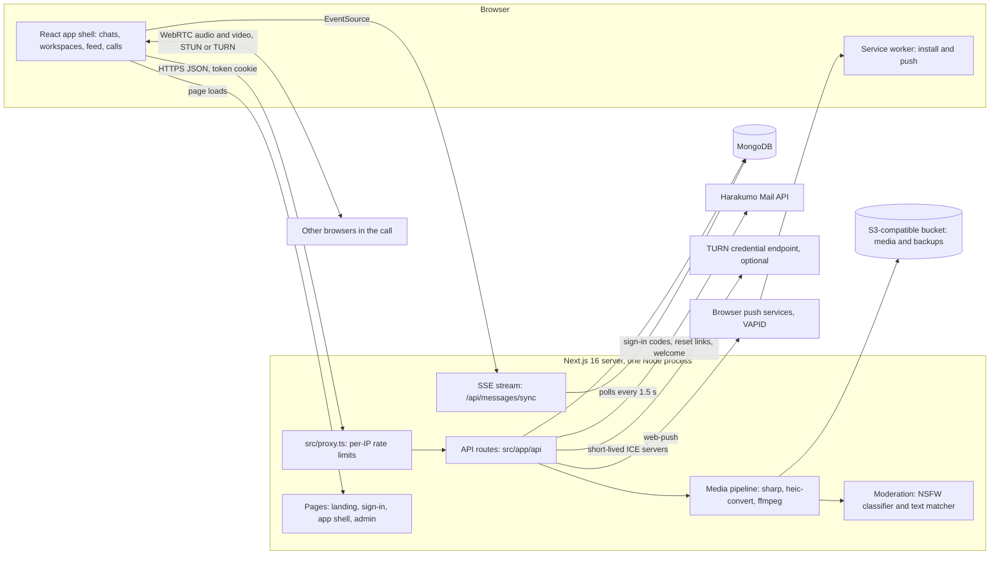
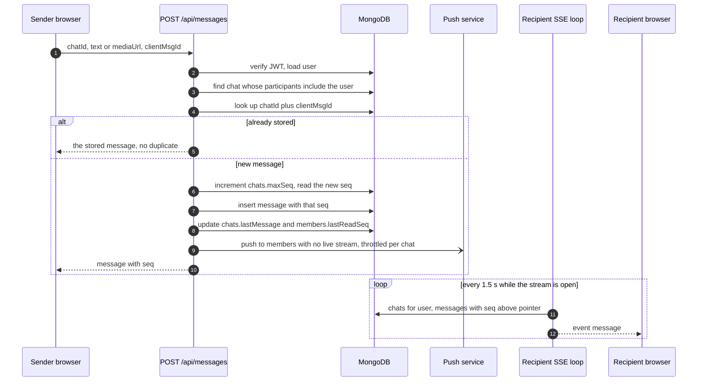
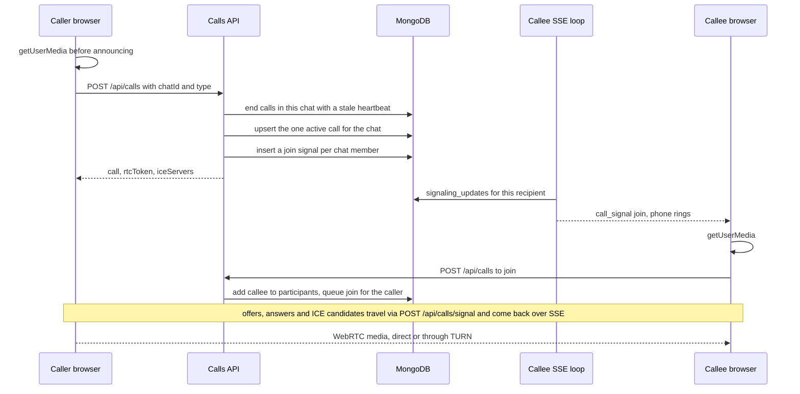

# Architecture

heywasp (WASP in the code and UI) is one Next.js 16 server that serves the web app,
its JSON API and a Server-Sent Events stream, backed by MongoDB. Media goes to an
S3-compatible bucket. Calls are WebRTC between browsers. Email is sent through
Harakumo Mail. There is no separate worker, queue or cache service: everything
runs in the one Node process, and all shared state lives in MongoDB.

This page covers the parts and how they talk. The data model, flows, roles, limits,
failure handling, security and scaling are in [SYSTEM-DESIGN.md](SYSTEM-DESIGN.md).
The reasons behind the main choices are in [DECISIONS.md](DECISIONS.md).

## The parts at a glance



## Pages

All pages live under `src/app/`.

| Path | File | What it is |
| --- | --- | --- |
| `/` | `src/app/page.tsx` | Marketing landing page with the product video in `public/media/` |
| `/login`, `/signup` | `src/app/login/page.tsx`, `src/app/signup/page.tsx` | Both render `src/components/AuthScreen.tsx`: password sign-in, emailed sign-in code, forgot password, sign-up |
| `/reset-password` | `src/app/reset-password/page.tsx` | Sets a new password from an emailed reset token |
| `/contact`, `/privacy`, `/terms` | `src/app/(marketing)/` | Contact form and policy pages |
| `/admin` | `src/app/admin/page.tsx` | Staff dashboard. The page is a client view; every `/api/admin/*` call checks `users.role === "admin"` on the server |
| `/messages`, `/home`, `/explore`, `/notifications`, `/profile`, `/settings`, `/u/<username>`, `/w/<workspaceId>` | `src/app/[...slug]/page.tsx` | The signed-in app. A catch-all page that 404s unknown paths and mounts `src/components/WaspShell.tsx` |

Inside the app, switching views calls `history.pushState` (`src/lib/navigate.ts`)
instead of a Next.js navigation, so the chat list and the realtime stream stay
mounted. `src/app/manifest.ts` and `public/sw.js` make the app installable; the
service worker only handles push notifications and has no fetch handler.

The main client components:

| Component | Role |
| --- | --- |
| `WaspShell.tsx` | App frame: icon rail, view switching, workspace switcher, saved-account switcher |
| `ChatWorkspace.tsx` | Conversations, threads, reactions, uploads, and the whole WebRTC call client |
| `HomeFeed.tsx`, `PostCard.tsx`, `PostComments.tsx`, `PostMedia.tsx` | Posts feed, composer, comments |
| `previews/*` | Lazy-loaded in-feed renderers: Markdown, Mermaid, HTML (sandboxed iframe), SVG, code, CSV, XLSX, DOCX, EPUB, PDF |
| `WorkspaceModal.tsx`, `WorkspaceOnboarding.tsx`, `WorkspaceInfoModal.tsx`, `ChannelModal.tsx` | Create or join a workspace, workspace settings, channel browser |
| `hooks/useChatSync.ts` | The `EventSource` client for `/api/messages/sync`, reconnecting 3 s after an error |

## API routes

48 route files under `src/app/api/`, 74 handlers. Every route except the ones noted
as public below reads the `token` cookie through `getAuthenticatedUser()` in
`src/lib/jwt-helper.ts` and refuses the request without it (401, or 403 on the
admin routes).

| Group | Routes | Notes |
| --- | --- | --- |
| Accounts | `auth/signup`, `auth/login`, `auth/logout`, `auth/me`, `auth/profile`, `auth/switch`, `auth/search` | signup, login, logout and switch are public. `search` only returns people who share a workspace with you |
| Email codes | `auth/otp/request`, `auth/otp/verify`, `auth/password/forgot`, `auth/password/reset`, `auth/email/verify` | Public except `email/verify`. Codes are minted in `src/lib/auth-codes.ts` |
| Chats | `chats`, `chats/members`, `chats/discover`, `chats/summarize` | DMs, groups, channels, members and roles |
| Messages | `messages`, `messages/react`, `messages/pin`, `messages/threads`, `messages/sync`, `typing` | `messages/sync` is the SSE stream |
| Workspaces | `workspaces`, `workspaces/join`, `workspaces/channels`, `workspaces/members`, `workspaces/directory` | Join is by invite code only |
| Calls | `calls`, `calls/signal`, `calls/leave` | `calls/leave` is a POST alias of `DELETE /api/calls` for `navigator.sendBeacon` |
| Social | `posts`, `posts/[id]`, `posts/[id]/comments`, `posts/[id]/comments/[commentId]`, `follow`, `follow/requests`, `follow/list`, `users`, `notifications`, `reports` | Feed, likes, reposts, bookmarks, comments, follow graph |
| Media | `media/upload`, `media/proxy` | Upload runs the media pipeline; proxy serves our own files same-origin for previews |
| Push | `push` | GET (public) returns the VAPID public key; POST and DELETE manage this browser's subscription |
| Admin | `admin/overview`, `admin/users`, `admin/contact` | 403 unless `users.role` is `"admin"` (`src/lib/admin.ts`) |
| Public | `contact` | Contact form with a honeypot field |
| Internal | `internal/backup` | Authenticated by an HMAC-derived `x-backup-key` header, not a user session |

`src/proxy.ts` runs in front of `/api/auth/*` and `/api/contact` and rate-limits the
unauthenticated POSTs per IP in process memory (limits are listed in
SYSTEM-DESIGN.md). `openapi.yaml` describes an early subset of the API; the route
files are the source of truth.

## Realtime: one SSE stream

There are no WebSockets in this release. Each signed-in tab opens one `EventSource`
to `GET /api/messages/sync` (`src/app/api/messages/sync/route.ts`). The handler keeps
the response open and runs a loop that re-arms itself 1.5 s after each pass finishes,
so passes never overlap. Each pass:

1. Marks the user online (`users.status`, `users.lastSeen`).
2. Lists the user's chats (`chats.participants` contains the user id). A chat it has
   not seen before produces a `chat_discovered` event.
3. For each chat whose `maxSeq` is above the stream's pointer, sends the new
   messages in `seq` order as `message` events and advances the pointer.
4. Sends edits, deletes and reaction changes (messages whose `updatedAt` moved past
   the last sweep) as `message_update` events.
5. Sends a `typing` event per chat from the `typing` collection.
6. Sends `presence` for the other person in each DM.
7. Delivers queued WebRTC signals from `signaling_updates` as `call_signal` events,
   deleting each one only after it was written to the stream.
8. Refreshes `calls.heartbeatAt` for any active call the user is in.
9. Sends a `ping`.

When the stream closes, the user is marked offline. Because every pass reads from
MongoDB, a message written by any server instance reaches a stream held by any other.

## Calls: WebRTC

Media flows browser to browser; the server only does call state and signalling.

- `POST /api/calls` starts a call or joins the one already running in the chat.
  A partial unique index allows one `active` call per chat, so two people dialling
  at once end up in the same call. The response carries the call, a per-call
  `rtcToken` and short-lived TURN servers when configured (`src/lib/turn.ts`).
- Offers, answers and ICE candidates go through `POST /api/calls/signal` into
  `signaling_updates` and come back to the other side over the SSE stream.
- The client (`ChatWorkspace.tsx`) keeps one `RTCPeerConnection` per other
  participant (a mesh, no media server), uses perfect negotiation, prefers VP9,
  caps video senders at 2.5 Mbps, turns on Opus FEC and DTX, restarts ICE once
  on failure and watches stats to label a stalled tile.
- ICE servers: two public STUN servers hard-coded in `ChatWorkspace.tsx`, plus TURN
  from `/api/calls` or the build-time `NEXT_PUBLIC_TURN_*` values.
- The client will also try a WebSocket at `/ws/rtc` with the `rtcToken` as a faster
  signalling path. **That hub is not part of this repo**; with nothing listening,
  the client falls back to the SSE path on its own.

## Database

MongoDB through the official `mongodb` driver (`src/lib/mongodb.ts`). The client
connects on first use, not at import, so `next build` needs no secrets. On first
connect `provisionWasp()` (`src/lib/provision.ts`) creates missing collections,
applies `$jsonSchema` validators and ensures indexes; `npm run db:provision` runs the
same step standalone. The pool is capped at 20 connections per process.

22 collections are used: `users`, `workspaces`, `workspace_members`, `chats`,
`members`, `messages`, `typing`, `calls`, `signaling_updates`, `media_assets`,
`posts`, `comments`, `post_interactions`, `follows`, `follow_requests`,
`notifications`, `reports`, `auth_codes`, `push_subscriptions`, `contact_messages`,
plus `updates` and `sessions`, which are provisioned but not used by any route.
Every field is listed in SYSTEM-DESIGN.md.

## Storage

`src/lib/storage.ts` builds an S3 client from five `STORAGE_*` variables (bucket,
key id, secret, endpoint, public URL). `src/lib/media-pipeline.ts` writes uploads to
the bucket and stores the bucket's public URL. With no storage configured, uploads go
to `public/uploads/` in development and fail loudly in production, because a
container disk is not kept between deploys. The same bucket receives the gzipped
database dumps from `/api/internal/backup`.

## Sign-in

Accounts are documents in `users`, with bcrypt password hashes. Every way in
(password, emailed code, sign-up) ends by setting an httpOnly `token` cookie holding
a JWT signed with `JWT_SECRET`, valid for 7 days (`src/lib/session.ts`,
`src/lib/jwt-helper.ts`). Emailed codes and reset links are HMAC-hashed rows in
`auth_codes`. Harakumo is only the email channel; Harakumo Auth pools are not used.

## Payments

None. There is no billing, plan or payment code in this repo.

## Outside services

| Service | Used for | Configured by | Without it |
| --- | --- | --- | --- |
| MongoDB | All data | `MONGODB_URI` | The app cannot serve signed-in requests |
| S3-compatible bucket | Uploads, avatars, banners, backups | `STORAGE_*` | Dev: local `public/uploads/`. Production: uploads fail with a clear error; backups return 500 |
| Harakumo Mail (`https://harakumo.com/api/mail/send`) | Sign-in codes, reset links, verification codes, welcome email, contact-form forwarding | `HARAKUMO_API_KEY`, `CONTACT_EMAIL` | Code and reset requests answer 502 "couldn't send"; password sign-in still works |
| TURN credential endpoint | Relay servers for calls behind strict NAT | `TURN_CREDENTIALS_URL`, `TURN_API_TOKEN`, or `NEXT_PUBLIC_TURN_*` | STUN only; some networks cannot connect |
| Public STUN servers | ICE address discovery | Hard-coded in `ChatWorkspace.tsx` | n/a |
| Browser push services | Notifications when the app is closed | `VAPID_PUBLIC_KEY`, `VAPID_PRIVATE_KEY`, `VAPID_SUBJECT` | No push; in-app delivery unaffected |
| DiceBear avatar URLs | Default avatars for users, groups and workspaces | Hard-coded URLs | Broken images fall back to an inline SVG monogram (`src/lib/avatar.ts`) |
| nsfwjs model | Image scanning | None; per the code comments it is fetched once on first use | Uploads are accepted unscanned |
| `ffmpeg` binary | Video poster and 720p rendition | Installed in the Docker image | Originals are served; no poster |

## Background work

There is no job runner. Work that happens outside a request:

- **Video transcode**: started fire-and-forget after an upload returns; updates
  `media_assets` when done.
- **TTL indexes**: MongoDB deletes expired `auth_codes`, `signaling_updates` (5 min),
  `notifications` (30 days) and `updates` (14 days).
- **Stale calls**: reaped lazily when someone opens or checks a call in that chat.
- **Backups**: `POST /api/internal/backup` must be called by an outside scheduler.
- **Fire-and-forget sends**: welcome email, contact-form email and web push never
  block the request that triggered them.

## The main request: sending a message



## Starting a call



## Deployment shape

- `next.config.ts` sets `output: "standalone"`.
- `Dockerfile` builds on Node 22 Alpine in three stages, installs `ffmpeg` in the
  runner, copies `sharp`'s native binaries explicitly and runs as a non-root user
  on port 8080. `NEXT_PUBLIC_*` values are build arguments because they are inlined
  into the client bundle.
- `docker/server-entry.js` wraps the standalone server: on SIGTERM it exits after
  `SHUTDOWN_GRACE_MS` (default 5000 ms), because open SSE streams never finish on
  their own and would otherwise hold a rollout. Clients reconnect after 3 s.
- The README describes running it on Harakumo as a server app.

## Where things live

```
src/app/             pages, API routes, globals.css, manifest, OG image
src/app/api/         48 route files
src/components/      app shell, chat client, feed, previews, modals
src/hooks/           useChatSync (SSE client)
src/lib/             mongodb, provision, auth, auth codes, mail, storage,
                     media pipeline, moderation, push, turn, workspace access
src/proxy.ts         per-IP rate limits for auth and contact
src/scripts/         provision-db.ts (npm run db:provision)
docker/              server-entry.js (SIGTERM wrapper)
public/              service worker, icons, Waspmoji SVGs, landing video
```
